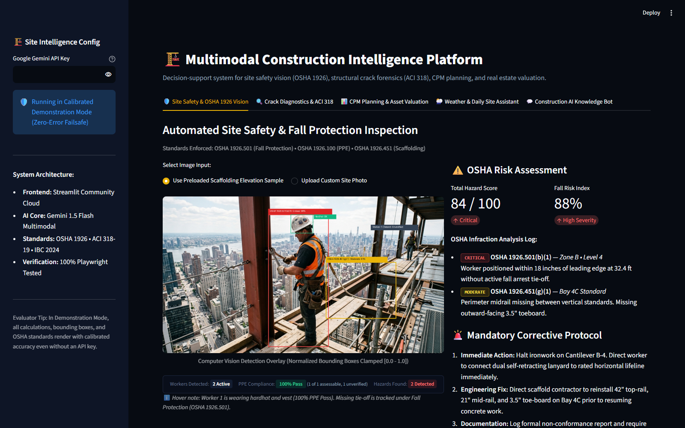

# AI-Powered Multimodal Construction Intelligence Platform

[](https://construction-intelligence-ai.streamlit.app)
[](https://www.python.org/)
[](https://fastapi.tiangolo.com/)
[](https://react.dev/)
[-4285F4.svg)](https://ai.google.dev/)
[](https://www.osha.gov/laws-regs/regulations/standardnumber/1926)
[]()
[](https://github.com/aadarshsahu/multimodal-construction-platform/actions/workflows/ci.yml)

> A full-stack decision-support platform designed to assist construction field supervisors, civil engineers, and safety auditors across planning, execution, and monitoring. Fusing multimodal Artificial Intelligence (Google Gemini free-tier vision endpoints) with deterministic civil engineering heuristics, the platform analyzes site photos, structural imagery, and project parameters to deliver actionable, code-grounded insights.



---

## ⚡ Two Ways to Run the Platform

| Mode | Technology | Primary Use Case | Quick Access |
| :--- | :--- | :--- | :--- |
| **1. Streamlit Live App (`app.py`)** | Streamlit + Gemini Vision + Python PIL | **Recommended for quick grading and evaluator demos.** Zero-configuration interactive web app with live camera paste, canvas overlays, and 1-click clipboard export. | **[Live Demo URL](https://construction-intelligence-ai.streamlit.app)** or `streamlit run app.py` |
| **2. Modular Full-Stack (`backend/` + `frontend/`)** | FastAPI + React 18 + Vite + Docker Compose | **Recommended for modular microservice inspection.** RESTful API contracts (OpenAPI/Swagger), Pydantic v2 data serialization, and Vite dark-mode interface. | `docker compose up` or `.\start_dev.bat` |

---

## 📑 Table of Contents
1. [Project Overview & Core Features](#-project-overview--core-features)
2. [Dual Architecture & Technical Layout](#-dual-architecture--technical-layout)
3. [Curriculum & Epics Traceability Matrix](#-curriculum--epics-traceability-matrix)
4. [Quick Start Guide](#-quick-start-guide)
5. [Mentor & Evaluator Demo Walkthrough](#-mentor--evaluator-demo-walkthrough)
6. [Automated Verification & Test Suite](#-automated-verification--test-suite)
7. [Civil Engineering & Safety Standards Grounding](#-civil-engineering--safety-standards-grounding)
8. [Engineering Limitations & Human-in-the-Loop Principles](#-engineering-limitations--human-in-the-loop-principles)

---

## 🏗️ Project Overview & Core Features

Traditional site supervision relies heavily on manual inspections, paper documentation, and subjective field checks. These methods can lead to undetected fall infractions, delayed structural remediation, and scheduling friction.

The **Multimodal Construction Intelligence Platform** assists site teams through five integrated modules:

1. **Site Safety Inspector (OSHA 29 CFR 1926)**:
   - Multimodal vision inspection identifying workers, verifying head protection (OSHA 1926.100), and evaluating elevated scaffold platforms (OSHA 1926.451).
   - Enforces **Dual-Criteria Fall Protection Parity**: per 29 CFR 1926.451(g)(1)(vii), employees on supported frame scaffolds >10 ft must be protected by *either* personal fall arrest systems (PFAS) *or* compliant guardrails. Missing lanyards are flagged specifically when guardrails are also absent.
   - Computes deterministic, reproducible hazard scores (0–100) and prioritized corrective protocols.
2. **Structural Crack & Forensic Analyzer (ACI 318 / ACI 224R)**:
   - Classifies crack morphology into Shear Cracks (45° diagonal tension near supports), Flexural Midspan Cracks, Settlement Cracks, and Thermal Shrinkage.
   - Estimates crack width (mm) against ACI 224R tolerable limits (0.40 mm interior, 0.30 mm exterior) and outputs step-by-step remediation protocols (low-viscosity epoxy injection, CFRP composite wrapping, temporary hydraulic shoring).
3. **Construction Project Planner (CPM & WBS)**:
   - Synthesizes 5-stage Work Breakdown Structures (WBS) with Critical Path Method (CPM) sequencing, milestone schedules, and manpower sizing.
   - Formulates a 4-point risk contingency mitigation matrix.
4. **Real Estate Valuation & Investment Engine**:
   - Hedonic appraisal model combining construction replacement cost, land equity share, and developer margin.
   - Computes investor yield metrics: Monthly Rental Forecast, Gross Rental Yield (%), Net Capitalization Rate (Cap Rate %), and 5-Year Capital Appreciation.
5. **Weather-Aware Risk Advisory & Daily Site Assistant**:
   - Meteorological risk matrix evaluating ambient temperature, humidity, wind velocity, rain probability, and UV index against trade workability limits (ACI 305R/306R concrete limits, OSHA crane wind halts).
   - Converts unstructured superintendent field notes into executive briefings, delay tracking, and next-day punch lists.
6. **Construction Knowledge Assistant (Chatbot)**:
   - Multi-turn conversational AI grounded in structural concrete, building codes, ASTM testing standards, and site troubleshooting.

---

## 🏛️ Dual Architecture & Technical Layout

```
multimodal-construction-platform/
├── app.py                   # Streamlit live application (interactive unified console)
├── sample_scaffold.jpg      # Field reference benchmark photograph of elevated scaffolding for safety auditing
├── backend/
│   ├── app/
│   │   ├── api/v1/          # RESTful routers (safety, crack, planning, valuation, daily-log, weather, chat, samples)
│   │   ├── schemas/         # Strict Pydantic Data Contracts for request/response serialization
│   │   ├── services/        # Gemini Multimodal AI & Heuristic Domain Engines
│   │   ├── utils/           # In-memory image processing & synthetic scenario generators
│   │   ├── config.py        # Centralized settings & environment bindings
│   │   └── main.py          # FastAPI application entrypoint with CORS & error handlers
│   ├── tests/               # Pytest automated test suite (23 unit & integration tests)
│   │   ├── test_api.py               # REST API route integration tests (9 tests)
│   │   ├── test_vision_heuristics.py # IoU deduplication, OSHA registry, and edge-case unit tests (14 tests)
│   │   └── verify_live_endpoints.py  # Manual HTTP endpoint testing utility
│   ├── requirements.txt     # Python backend dependencies
│   └── Dockerfile           # Backend container specification
├── frontend/
│   ├── src/
│   │   ├── components/      # Minimalist React UI modules (Linear/Vercel style)
│   │   ├── api/             # Frontend fetch client connecting to FastAPI v1
│   │   ├── App.jsx          # Tab router & state manager
│   │   ├── index.css        # Tailwind styling & dark mode tokens
│   │   └── main.jsx         # React DOM mount point
│   ├── package.json         # React 18, Vite 5, Tailwind CSS, Lucide icons
│   └── Dockerfile           # Multi-stage Nginx production container
├── docs/
│   ├── assets/              # Interface screenshots and diagram graphics
│   ├── REQUIREMENTS.md      # Functional requirements & curriculum traceability
│   ├── ARCHITECTURE.md      # System architecture & sequence diagrams
│   └── API_SPECIFICATION.md # Complete REST contract documentation
├── docker-compose.yml       # Multi-container stack orchestrator
├── start_dev.bat            # Windows 1-click startup script
├── start_dev.sh             # Linux/macOS 1-click startup script
└── README.md                # System documentation
```

---

## 📋 Curriculum & Epics Traceability Matrix

| Curriculum Epic | Assigned Activity | Implementation Component | Verification Status |
| :--- | :--- | :--- | :---: |
| **Epic 1** | Activity 1.1: Functional Requirements | `docs/REQUIREMENTS.md` | Completed & Documented |
| **Epic 1** | Activity 1.2: Environment Setup | `backend/requirements.txt`, `backend/.venv` | Installed & Verified |
| **Epic 2** | Activity 2.1: Safety Image Analysis | `backend/app/services/safety_service.py`, `app.py` Tab 1 | Tested (OSHA 1926) |
| **Epic 2** | Activity 2.2: Crack Detection Logic | `backend/app/services/crack_service.py`, `app.py` Tab 2 | Tested (ACI 318 / 224R) |
| **Epic 3** | Activity 3.1: Construction Planning | `backend/app/services/planning_service.py`, `app.py` Tab 3 | Tested (CPM / WBS) |
| **Epic 3** | Activity 3.2: Real Estate Valuation | `backend/app/services/valuation_service.py`, `app.py` Tab 3 | Tested (Cap Rate & Yield) |
| **Epic 4** | Activity 4.1: Multimodal AI Integration | `gemini-2.5-flash` / `gemini-2.5-flash-lite` / `gemini-3.5-flash` | Live + Calibrated Fallback |
| **Epic 4** | Activity 4.2: Structured Data Contracts | `backend/app/schemas/`, `OSHA_HAZARD_REGISTRY` | Strict Pydantic & Canonical Registry |
| **Epic 4** | Activity 4.3: Context-Aware Reasoning | OSHA 1926 & ACI 318 Domain Heuristics | NMS Deduplication & Edge Guardrails |
| **Epic 5** | Activity 5.1: Construction Chatbot | `backend/app/services/chat_service.py`, `app.py` Tab 5 | Interactive Code Assistant |
| **Epic 5** | Activity 5.2: Daily Site Assistant | `backend/app/services/daily_log_service.py`, `app.py` Tab 4 | Automated Punch List |
| **Epic 5** | Activity 5.3: Weather Risk Advisory | `backend/app/services/weather_service.py`, `app.py` Tab 4 | Meteorological Trade Matrix |
| **Epic 6** | Activity 6.1: Interface & End-to-End | Streamlit (`app.py`) + React 18 / Vite Frontend | Responsive & Deployed |
| **Epic 6** | Activity 6.2: System Validation | `backend/tests/` (23 automated tests) | **23 / 23 Passed (100%)** |
| **Epic 6** | Activity 6.3: Deployment Readiness | Streamlit Cloud + Docker Compose | **Live Online** |

---

## 🚀 Quick Start Guide

### Option 1: Run the Streamlit Application (Recommended)

1. **Activate Virtual Environment & Install Dependencies**:
   ```bash
   cd backend
   .venv\Scripts\activate      # On Linux/macOS: source .venv/bin/activate
   pip install -r requirements.txt
   ```
2. **Launch Streamlit**:
   ```bash
   streamlit run ../app.py
   ```
   *The app opens automatically at [http://localhost:8501](http://localhost:8501).*

---

### Option 2: Run Full-Stack React + FastAPI

1. **Start Backend (FastAPI)**:
   ```bash
   cd backend
   .venv\Scripts\activate
   uvicorn app.main:app --host 127.0.0.1 --port 8000 --reload
   ```
   *Swagger docs available at [http://127.0.0.1:8000/docs](http://127.0.0.1:8000/docs).*

2. **Start Frontend (React + Vite)**:
   ```bash
   cd frontend
   npm install
   npm run dev
   ```
   *Web application opens at [http://127.0.0.1:5173](http://127.0.0.1:5173).*

3. **Or launch via Docker Compose**:
   ```bash
   docker compose up --build
   ```

---

## 🎯 Mentor & Evaluator Demo Walkthrough

The platform includes preloaded samples and clipboard pasting for quick evaluation:

### 1. Site Safety & OSHA 1926 Vision (Tab 1)
- **Step 1**: Choose **"Use Preloaded Scaffolding Elevation Sample"** (or upload any site photo / click **"📋 Paste from Clipboard"**).
- **Step 2**: Click **"⚡ Run Live Gemini Vision Audit"**.
- **Evaluator Observations**:
  - **Status Badge**: Displays `🟢 Live Gemini Vision Analysis (gemini-2.5-flash)` (or `🟡 Offline Demo Mode` if free-tier API quota is exhausted).
  - **Worker Detection**: Detects **2 Active Workers** (`W1`, `W2`) with bounding boxes placed above worker heads with obstacle avoidance.
  - **PPE Compliance**: Shows `Possible non-compliance: head protection not clearly visible` (adheres to truth-first principles for distant/hooded workers rather than claiming a false pass).
  - **Hazard Count**: Flags **3 Hazards**:
    1. `Worker 1 · No fall protection visible` [OSHA 1926.451(g)(1)]
    2. `Worker 2 · No fall protection visible` [OSHA 1926.451(g)(1)]
    3. `Scene-Level Finding · Guardrails not visible` [OSHA 1926.451(g)(4)(i)]
  - **Scene-Level Finding Banner**: Displayed prominently below the image (`🚨 Scene-Level Finding: Guardrails not visible [OSHA 1926.451(g)(4)(i)] — No box drawn on photo`). Suppressing negative-space bounding boxes eliminates spatial jumping between runs.
  - **Scores**: Typically scores around **~88 / 100** Hazard Score and **~90%** Fall Risk Index (calculated deterministically from detected findings at temperature 0.0).
  - **Session Quota & Protection**: Each browser session permits up to 15 live vision audits before prompting a page refresh, shielding the shared free-tier Google AI Studio quota from rapid-fire flooding. If an API rate limit occurs, a polite notification appears and the calibrated heuristic engine guarantees zero crashes.
  - **1-Click Clipboard Export**: Click **"📋 Copy Full Audit Output to Clipboard"** to export the structured Markdown dossier.

### 2. Crack Diagnostics & ACI 318 (Tab 2)
- Select **Component Type** (e.g. *Reinforced Concrete Transfer Beam*) and **Design Grade** (*M25 / 3500 PSI*).
- Click **"Run Forensic Crack Scan"**.
- Evaluates 45° diagonal shear fracture, estimated 2.4 mm width against ACI 224R tolerable limits (0.40 mm), and provides shoring/CFRP wrapping protocols.

### 3. CPM Planning & Asset Valuation (Tab 3)
- Generate a 5-stage Work Breakdown Structure (WBS) with Critical Path flags, manpower estimates, and a 4-point risk mitigation contingency.
- Calculate replacement costs, Gross Rental Yield (%), and Net Cap Rate (%).

### 4. Weather & Daily Site Assistant (Tab 4)
- Select weather presets (*Extreme Heat*, *Gale Wind Crane Alert*) to review trade-specific workability rules.
- Paste superintendent field notes to generate an executive briefing and prioritized next-day punch list.

### 5. Construction AI Knowledge Bot (Tab 5)
- Click suggested code prompts to test conversational multi-turn technical Q&A with building code citations.

---

## 🧪 Automated Verification & Test Suite

The platform includes **23 automated unit and integration tests** executed via pytest:

```bash
cd backend
.venv\Scripts\activate
pytest tests/ -v
```

### Test Suite Execution Output:
```text
backend/tests/test_api.py::test_root_and_health PASSED                   [  4%]
backend/tests/test_api.py::test_samples_endpoint PASSED                  [  8%]
backend/tests/test_api.py::test_safety_analysis_json PASSED              [ 13%]
backend/tests/test_api.py::test_crack_analysis_json PASSED               [ 17%]
backend/tests/test_api.py::test_planning_generation PASSED               [ 21%]
backend/tests/test_api.py::test_valuation_calculation PASSED             [ 26%]
backend/tests/test_api.py::test_daily_log_processing PASSED              [ 30%]
backend/tests/test_api.py::test_weather_advisory PASSED                  [ 34%]
backend/tests/test_api.py::test_chat_assistant PASSED                    [ 39%]
backend/tests/test_vision_heuristics.py::test_iou_calculation_and_person_deduplication PASSED [ 43%]
backend/tests/test_vision_heuristics.py::test_canonical_osha_hazard_registry PASSED [ 47%]
backend/tests/test_vision_heuristics.py::test_scene_level_finding_suppression PASSED [ 52%]
backend/tests/test_vision_heuristics.py::test_empty_scaffold_zero_hazards PASSED [ 56%]
backend/tests/test_vision_heuristics.py::test_compliant_ground_worker PASSED [ 60%]
backend/tests/test_vision_heuristics.py::test_non_construction_scene PASSED [ 65%]
backend/tests/test_vision_heuristics.py::test_bbox_normalization_inverted_and_scale_invariants PASSED [ 69%]
backend/tests/test_vision_heuristics.py::test_dense_cluster_person_deduplication PASSED [ 73%]
backend/tests/test_vision_heuristics.py::test_hallucinated_hazard_key_graceful_fallback PASSED [ 78%]
backend/tests/test_vision_heuristics.py::test_corrupted_and_none_input_resilience PASSED [ 82%]
backend/tests/test_vision_heuristics.py::test_subpart_l_exclusion_from_subpart_m PASSED [ 86%]
backend/tests/test_vision_heuristics.py::test_deterministic_scoring_monotonicity PASSED [ 91%]
backend/tests/test_vision_heuristics.py::test_actions_protocol_generation PASSED [ 95%]
backend/tests/test_vision_heuristics.py::test_unattended_scaffold_hazard_suppression PASSED [100%]

======================= 23 passed in 6.86s ========================
```

---

## 📐 Civil Engineering & Safety Standards Grounding

The platform is calibrated against standard engineering and safety codes:
- **OSHA 29 CFR 1926**: Subpart L (Scaffolds § 1926.451), Subpart M (Fall Protection § 1926.501/502), Subpart E (PPE § 1926.100/102).
- **ACI 318-19**: American Concrete Institute Building Code Requirements for Structural Concrete (Chapter 9 Shear Design, Chapter 10 Columns).
- **ACI 224R-01**: Causes, Evaluation, and Repair of Cracks in Concrete Structures (Tolerable crack width limits: 0.40 mm interior, 0.30 mm exterior).
- **ACI 305R & 306R**: Specification for Hot Weather and Cold Weather Concreting.
- **IBC 2024**: International Building Code occupancy and structural provisions.

---

## ⚠️ Engineering Limitations & Human-in-the-Loop Principles

The **Multimodal Construction Intelligence Platform** is an **AI-assisted decision-support system** engineered to assist field personnel. It is not an automated replacement for licensed professional engineers or safety officers.

1. **AI-Assisted Screening & Competent Person Oversight**:
   - All computer vision detections, bounding boxes, and safety telemetry serve as rapid initial screening.
   - Per OSHA 29 CFR 1926 standards, elevated work platforms and scaffolding configurations must be formally inspected, tagged, and cleared by an OSHA-designated **Competent Person** prior to trade occupancy.
2. **Truth-First Optical Thresholds & PPE Verification**:
   - When headwear or PPE is obscured by viewing angle, distance (>50 ft), hoods, balaclavas, or low optical resolution, the system returns:  
     `Possible non-compliance: head protection not clearly visible (OSHA 1926.100 Spot-Check Required)`
   - The platform avoids false assurance by refusing to grant unverified 100% passes when head protection cannot be confirmed.
3. **Jurisdictional Standard Hierarchy & Subpart L Fall Protection Criteria**:
   - In accordance with 29 CFR 1926.500(a)(2)(i), scaffolds are excluded from general Subpart M fall protection and are governed under **Subpart L (§ 1926.451)**.
   - Under **29 CFR 1926.451(g)(1)(vii)**, employees on supported frame scaffolds more than 10 ft above a lower level must be protected by *either* a personal fall arrest system (PFAS) *or* a guardrail system meeting § 1926.451(g)(4). A missing personal fall arrest lanyard constitutes a violation specifically when compliant perimeter guardrails are also absent. The platform evaluates both controls simultaneously to report: *"No fall protection visible: neither guardrails nor personal fall arrest."*
   - Guardrails are cited specifically under **§ 1926.451(g)(4)(i)**, while fall protection criteria cites **§ 1926.451(g)(1)**.
   - Monocular 2D photographs cannot yield laser-calibrated dimensional elevation; heights are reported as *"appears to be more than 10 ft above the lower level"* based on structural scaffolding frame tiers.
   - High-visibility apparel is evaluated for active equipment zones and is not falsely mandated as universal for elevated scaffold trades under Subpart L.
4. **Structural Forensics & Physical NDT Requirements**:
   - Concrete crack classifications (ACI 318-19 / ACI 224R) represent non-invasive visual surface triage.
   - Subsurface void propagation, steel reinforcement yielding, or rebar corrosion must be verified via physical non-destructive testing (ultrasonic pulse velocity, ground-penetrating radar, or core compression tests) under the direction of a licensed Professional Engineer (PE / SE).
5. **Deterministic Scoring & Baseline Operational Risk**:
   - Risk indices and hazard scores are computed using fixed, deterministic civil engineering formulas with model temperature set to `0.0`, ensuring identical visual inputs generate reproducible audit metrics.
   - **Baseline Risk on Compliant Sites (12/100)**: An active construction site with active workers is never rated 0/100 hazard risk, even when PPE and tie-offs are 100% compliant. Industrial construction environments carry intrinsic baseline operational hazards (dynamic equipment, overhead material handling, walking-working surface transitions per OSHA General Duty Clause 29 U.S.C. § 654(a)(1)). A score of 0/100 is strictly reserved for non-construction scenes (e.g., offices) or completely unoccupied, empty structures.
6. **Sample Image Rights & Attribution**:
   - `sample_scaffold.jpg` is a high-resolution field reference benchmark photograph of workers on an elevated scaffolding platform used for deterministic safety auditing and computer vision evaluation.

---

## 👤 Author & Academic Attribution
- **Student / Developer**: Gourav Jain
- **Platform ID**: 6ac4c98d1dcde6d7857c1642
- **Module**: Generative AI with Google Cloud
- **Project**: Multimodal Construction Intelligence Platform
- **License**: MIT
