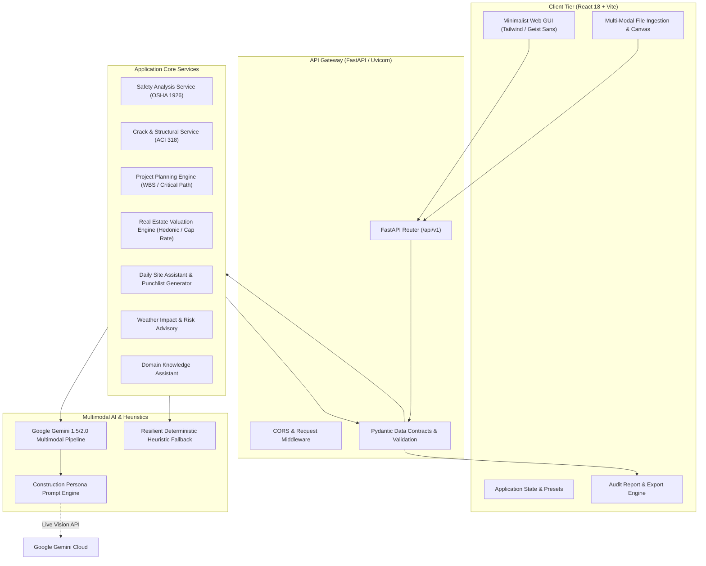
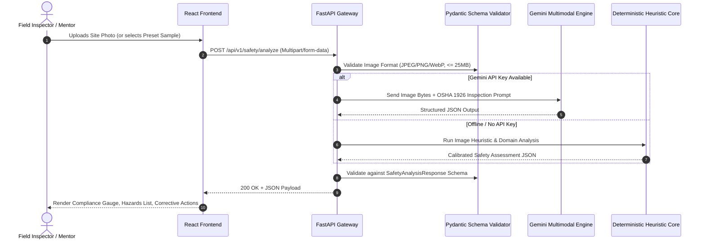

# Technical Architecture & System Design
## Multimodal Construction Intelligence Platform

### 1. High-Level Architecture Overview

The system employs a modern, decoupled client-server architecture with an intelligent multimodal AI processing pipeline.

---

### 2. Component Breakdown

#### A. Presentation Tier (`frontend/`)
- **Technology**: React 18, Vite 5, Tailwind CSS, Lucide React icons.
- **Design Paradigm**: Strict Linear/Vercel minimalist aesthetic (dark mode `#0A0A0A`, `#18181B`, `#FAFAFA` typography, ultra-subtle `#27272A` borders, zero rainbow clutter).
- **Core Views / Tabs**:
  1. **Site Safety Inspector**: Image upload with zoom & pan, PPE compliance gauges, detected hazards table with OSHA violation citations, immediate corrective actions.
  2. **Crack & Structural Analyzer**: Concrete & masonry crack visual triage, crack width/pattern classifier, risk severity meter, structural remediation specs.
  3. **Construction Project Planner**: Interactive parameters (area, budget, project type), 5-phase WBS timeline, Gantt breakdown, labor crew allocation, risk matrix.
  4. **Real Estate Valuation Engine**: Property attributes, valuation estimate range, square foot rate, land-to-building ratio, rental yield & cap rate forecasting.
  5. **Daily Site Assistant**: Field supervisor notes processor, workforce log, blocker/delay detection, automated punch list.
  6. **Weather Advisory Engine**: Weather risk matrix across 5 construction trades (Concrete curing, Tower cranes, Painting/waterproofing, Deep trenching, High-elevation roofing).
  7. **Construction Knowledge Chatbot**: Interactive multi-turn assistant grounded in building codes, concrete mix ratios, and standard operating procedures.
  8. **Executive Report Generator**: Clean, printable PDF/HTML formatted site audit summary.

#### B. API Gateway & Validation Tier (`backend/app/api/` & `schemas/`)
- **Technology**: FastAPI, Pydantic v2.
- **Role**: Validates every incoming HTTP payload and enforces strict schema serialization on all AI model outputs.
- **Fail-Safe Guarantee**: Even if an LLM outputs malformed JSON or times out, the system catches formatting anomalies and sanitizes responses through structured fallback parsers.

#### C. Multimodal AI Intelligence Tier (`backend/app/services/gemini_client.py`)
- **Technology**: Google Generative AI (`gemini-1.5-flash` / `gemini-2.0-flash` or configurable).
- **Dual Engine Execution**:
  - **Live Mode**: Calls Gemini API with high-resolution image bytes and specialized construction engineering prompt templates.
  - **Deterministic Engine**: Realistic, domain-calibrated rule-based engine providing instant analysis when no API key is set or when working offline. This guarantees 100% demo uptime and friction-free evaluation by instructors/mentors!

---

### 3. Data Flow Sequence (Safety Inspection Example)

